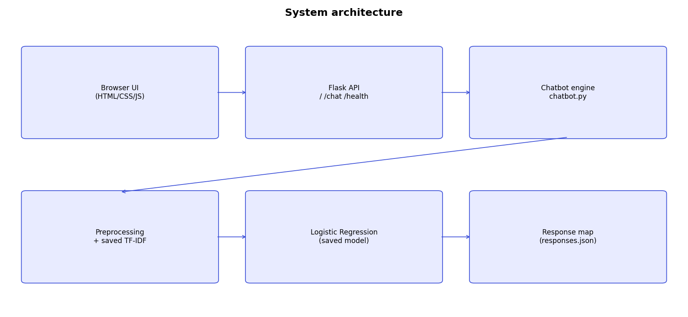
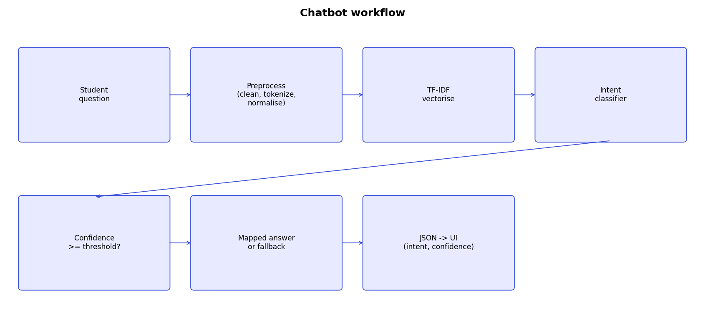

# AI Chatbot for Student Queries

A working NLP chatbot that answers college questions through a web UI. Pipeline: **preprocessing -> TF-IDF -> Logistic Regression intent classifier -> confidence check -> response mapping -> Flask JSON API -> chat UI.**

> **Data disclaimer:** the college is a fictional *Sample Institute of Technology (SIT)*. All answers (fees, dates, phone, etc.) are **illustrative sample data**, not verified facts. The 299 questions are self-created by the project author (paraphrases/typos a student might type). Replace `dataset/build_dataset.py` content with verified details from your college website, FAQ page and brochure before real use.

## Problem statement
Students repeatedly ask the college office the same questions (admission, fees, hostel...). A chatbot that understands varied phrasings can answer them instantly.

## Objectives
Understand varied student questions with NLP; classify intent with ML; answer with confidence-aware fallback; serve through a responsive web interface and REST API.

## Methodology and architecture



1. **Dataset** - `dataset/college_faq_dataset.csv` (question, intent, answer): 299 questions, 13 intents. Built by `dataset/build_dataset.py` (edit and re-run to extend).
2. **Preprocessing** (`preprocessing.py`, single function used in training *and* prediction): lowercase, punctuation/special-character removal, tokenization, spelling/slang normalisation (e.g. *hostle*->hostel), light stemming (fees->fee), stopword removal. Written without NLTK (no external downloads needed).
3. **TF-IDF**: scikit-learn `TfidfVectorizer` - word 1-2-grams + character 2-4-grams (robust to typos). Fitted once on training data, saved to `models/tfidf_vectorizer.joblib`, only `.transform()` at prediction time.
4. **Classifier**: Logistic Regression (compared against LinearSVC and Multinomial NB by 5-fold CV).
5. **Confidence threshold** = 0.35 (`CONFIDENCE_THRESHOLD` env var). Below it - or if no known words - the bot returns a fallback and refers to the college office.
6. **Response mapping**: `dataset/responses.json` (intent -> answer).

## Project structure
```
app.py  chatbot.py  preprocessing.py  train_model.py  requirements.txt  Procfile  render.yaml
dataset/ (build_dataset.py, college_faq_dataset.csv, responses.json)
models/  (tfidf_vectorizer.joblib, intent_model.joblib)   templates/index.html   static/ (style.css, app.js)
tests/   (test_chatbot.py, test_results.md)   reports/ (metrics, report, confusion matrix)   docs/ (diagrams)
```

## Run locally
```bash
python -m venv venv && source venv/bin/activate      # Windows: venv\Scripts\activate
pip install -r requirements.txt
python dataset/build_dataset.py && python train_model.py   # optional: models are already included
python app.py                                         # open http://localhost:5000
python -m unittest tests.test_chatbot -v              # run tests
```
Requirements: Python 3.9+, any modern browser, ~200 MB RAM, no GPU. Software: Flask, scikit-learn, pandas, numpy, joblib, matplotlib.

## Deploy (Render, free tier)
Push this folder to GitHub -> Render -> New Web Service -> select repo (it reads `render.yaml`) -> deploy. Build trains the model; start command is `gunicorn app:app`. Alternatives: Railway / PythonAnywhere using the `Procfile`. After deploying, open `<url>/health` and ask a question to verify.

## API
| Endpoint | Description |
|---|---|
| GET `/` | Chat UI |
| GET `/health` | `{"status":"ok","model_loaded":true,"threshold":0.35}` |
| POST `/chat` | Body `{"question":"..."}`. Returns `intent`, `confidence`, `answer`, `is_fallback`, `best_guess`, `cleaned_question`, `top3`. 400 on empty input, 500 on server error. |

## Evaluation (real output of `train_model.py`)
Stratified 80/20 split (239 train / 60 test). Deployed model is refit on all 299 samples; metrics below are from the split model.
```json
{
  "model": "TF-IDF (word 1-2 + char 2-4 grams) + LogisticRegression",
  "train_size": 239,
  "test_size": 60,
  "accuracy": 0.9,
  "precision_weighted": 0.9254,
  "recall_weighted": 0.9,
  "f1_weighted": 0.9007,
  "model_comparison_cv": {
    "LogisticRegression": {
      "cv_accuracy_mean": 0.8452,
      "cv_accuracy_std": 0.0281
    },
    "LinearSVC": {
      "cv_accuracy_mean": 0.845,
      "cv_accuracy_std": 0.0435
    },
    "MultinomialNB": {
      "cv_accuracy_mean": 0.8701,
      "cv_accuracy_std": 0.0342
    }
  }
}
```
```
                   precision    recall  f1-score   support

academic_calendar       0.80      1.00      0.89         4
        admission       0.62      1.00      0.77         5
          contact       1.00      0.80      0.89         5
          courses       1.00      0.80      0.89         5
      eligibility       1.00      0.60      0.75         5
     examinations       1.00      1.00      1.00         4
             fees       0.80      0.80      0.80         5
         greeting       1.00      0.80      0.89         5
           hostel       1.00      1.00      1.00         4
      internships       1.00      1.00      1.00         4
          library       1.00      1.00      1.00         5
       placements       0.80      1.00      0.89         4
     scholarships       1.00      1.00      1.00         5

         accuracy                           0.90        60
        macro avg       0.93      0.91      0.90        60
     weighted avg       0.93      0.90      0.90        60
```
Confusion matrix (rows=true, cols=predicted; image: `reports/confusion_matrix.png`):
```
                   academic_calendar  admission  contact  courses  eligibility  examinations  fees  greeting  hostel  internships  library  placements  scholarships
academic_calendar                  4          0        0        0            0             0     0         0       0            0        0           0             0
admission                          0          5        0        0            0             0     0         0       0            0        0           0             0
contact                            0          0        4        0            0             0     0         0       0            0        0           1             0
courses                            0          0        0        4            0             0     1         0       0            0        0           0             0
eligibility                        0          2        0        0            3             0     0         0       0            0        0           0             0
examinations                       0          0        0        0            0             4     0         0       0            0        0           0             0
fees                               0          1        0        0            0             0     4         0       0            0        0           0             0
greeting                           1          0        0        0            0             0     0         4       0            0        0           0             0
hostel                             0          0        0        0            0             0     0         0       4            0        0           0             0
internships                        0          0        0        0            0             0     0         0       0            4        0           0             0
library                            0          0        0        0            0             0     0         0       0            0        5           0             0
placements                         0          0        0        0            0             0     0         0       0            0        0           4             0
scholarships                       0          0        0        0            0             0     0         0       0            0        0           0             5
```
**Honest caveat:** after the first training run (74% accuracy on 39 test items, 195 questions) I inspected the errors, fixed two preprocessing bugs and added ~100 paraphrases. The 90% figure is therefore slightly optimistic because I saw the first test split's errors. The second check below uses brand-new questions written separately and was run once, without tuning on it.

## Test results (`tests/test_results.md`, 38 unseen / misspelled / unrelated questions)
| Test question | Expected | Predicted | Confidence | Status |
|---|---|---|---|---|
| How do I get a seat in your college? | admission | admission | 0.672 | PASS |
| what is the procedure for applying here | admission | admission | 0.661 | PASS |
| Which programs can I pursue at your institute? | courses | courses | 0.510 | PASS |
| is there a civil engineering department | courses | courses | 0.889 | PASS |
| What will I have to pay every year? | fees | fees | 0.392 | PASS |
| tell me the tuition for MCA | fees | fees | 0.381 | PASS |
| Do I qualify for mba with 55 percent? | eligibility | eligibility | 0.452 | PASS |
| what are the minimum marks needed in 12th for btech | eligibility | eligibility | 0.864 | PASS |
| Can students do internships during the course? | internships | internships | 0.913 | PASS |
| how long is the training period in companies | internships | unknown | 0.248 | FAIL |
| What is the average salary offered to students? | placements | placements | 0.580 | PASS |
| do top companies recruit from your campus | placements | placements | 0.786 | PASS |
| Is there any scholarship for merit students? | scholarships | scholarships | 0.978 | PASS |
| how can poor students get fee waiver | scholarships | scholarships | 0.844 | PASS |
| When do the holidays begin? | academic_calendar | academic_calendar | 0.932 | PASS |
| what are the semester start dates | academic_calendar | academic_calendar | 0.932 | PASS |
| What are the passing marks in exams? | examinations | examinations | 0.989 | PASS |
| where can I see my exam results | examinations | examinations | 0.960 | PASS |
| Does the college provide hostel rooms? | hostel | hostel | 0.782 | PASS |
| is food available in the hostel mess | hostel | hostel | 0.938 | PASS |
| What time does the library close in the evening? | library | library | 0.848 | PASS |
| can I borrow books from the library | library | library | 0.990 | PASS |
| What is the phone number of the college? | contact | contact | 0.951 | PASS |
| where is your college located | contact | contact | 0.863 | PASS |
| Hello there! | greeting | greeting | 0.976 | PASS |
| thanks, bye | greeting | greeting | 0.978 | PASS |
| admision procdure | admission | admission | 0.973 | PASS |
| hostle fees | hostel | hostel | 0.977 | PASS |
| scholarsip details | scholarships | scholarships | 0.964 | PASS |
| placment record | placements | placements | 0.932 | PASS |
| libary timings | library | library | 0.945 | PASS |
| exm timetable | examinations | examinations | 0.915 | PASS |
| fees | fees | fees | 0.991 | PASS |
| Who won the cricket world cup? | unknown | unknown | 0.162 | PASS |
| what is the capital of France | unknown | unknown | 0.133 | PASS |
| tell me a joke about pizza | unknown | unknown | 0.161 | PASS |
| asdfgh qwerty | unknown | unknown | 0.230 | PASS |
| how to cook biryani | unknown | unknown | 0.241 | PASS |

## Limitations
Small self-made dataset (~23 per intent); no multi-turn memory (each question is classified independently); one intent per question; sample data only; threshold chosen heuristically; English only (no Hindi/Kannada); Not evaluated with real student queries.

## Future enhancements
Collect real student queries; multi-turn context; multilingual support; admin panel to edit FAQs; semantic embeddings; logging unanswered questions for retraining; live-agent handoff.

## References
scikit-learn docs (TfidfVectorizer, LogisticRegression); Flask docs; Jurafsky & Martin, *Speech and Language Processing*; Salton & Buckley (1988) on term weighting. Dataset: self-created illustrative FAQ (no scraped data).
